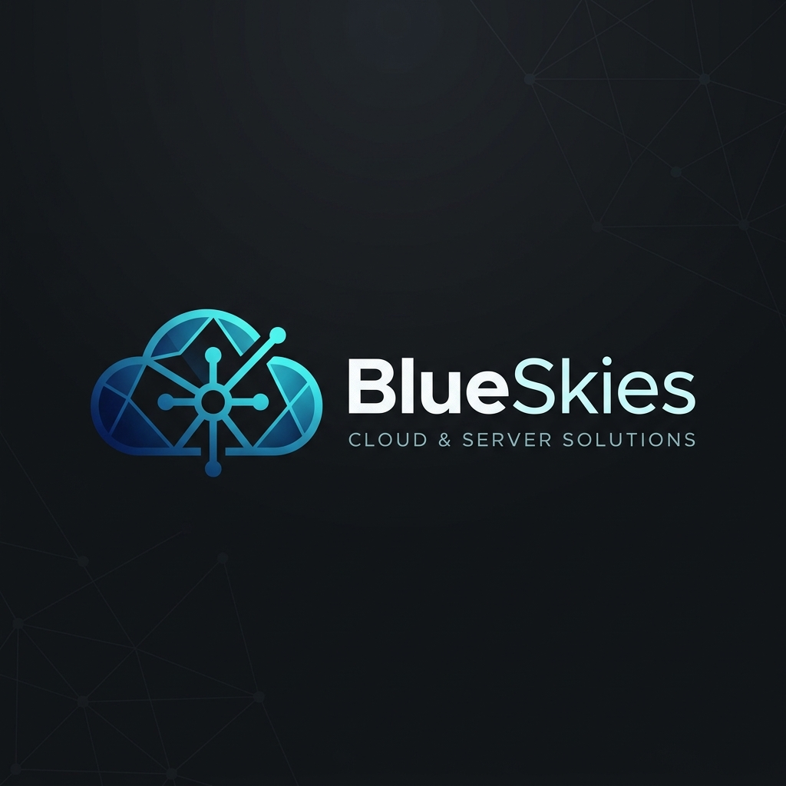
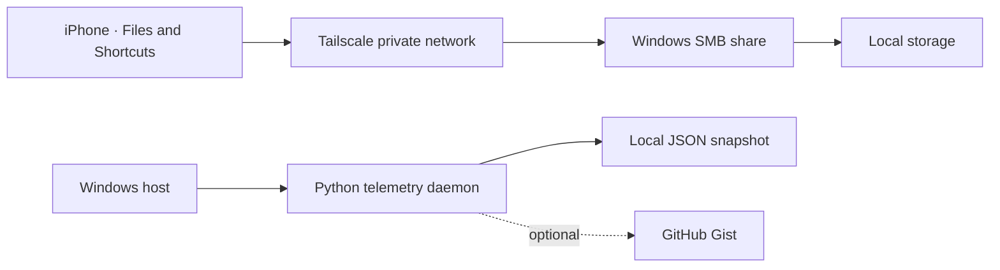

<div align="center">
  
  <h1>BlueSkies</h1>
  <p><strong>A personal cloud built from hardware you already own.</strong></p>
  <p><a href="https://saisiddharthbs.github.io/BlueSkies_Server/">Explore the visual overview</a></p>
</div>

BlueSkies documents a home NAS and photo-backup setup built around a Windows storage host, Tailscale, SMB file sharing, and iOS Shortcuts. A Python daemon collects basic host metrics. The website in this repository presents the architecture; it is a static visualization, not a live control panel.

## The problem

Photos and files outgrow a phone. A home machine can store original files and make them reachable from trusted devices without placing every backup in a third-party cloud account. That trades a subscription for ownership of the hardware, setup, maintenance, power, and backups.

## System at a glance



| Part | Role |
| --- | --- |
| Windows host and storage | Holds files and exposes a private SMB share |
| Tailscale | Connects trusted devices over a private mesh network |
| iOS Shortcuts | Schedules copies of selected photos to the share |
| FileBrowser | Optional browser interface for files on the host |
| Telemetry daemon | Records CPU load, memory, free space, uptime, and selected process states |
| Static website | Explains the build with diagrams and illustrative telemetry |

## What is in this repository

```text
index.html, style.css, script.js   Static architecture website
telemetry_daemon.py                Host metrics collector and optional Gist publisher
Install-MovieBots.bat              Optional media-stack setup script
Start-WebShare-App.bat             FileBrowser launch script
FileBrowser/                       Bundled third-party browser binary and its license
BlueSkies_Project_Report.md        Build notes and decisions
AI_Monitor_Blueprint.md            Unimplemented monitoring concept
```

The media stack and AI monitor are separate from the core photo-backup path. The AI monitor is a blueprint, not a deployed feature. The website uses simulated display states, so its visuals are not evidence of current host health.

## Reproduce the core backup path

1. Choose a Windows machine and storage drive with enough free space for the files you expect to keep. Plan a second backup for anything irreplaceable; one NAS disk is not a backup strategy by itself.
2. Install Tailscale on the host and your phone, and confirm both devices can reach each other over your private network.
3. Create a dedicated SMB share and account with only the access needed for backups. Do not expose SMB directly to the public internet.
4. In iOS Shortcuts, create an automation that saves selected photos to that share. Run it manually once, inspect the copied files, and only then schedule it.
5. Optionally run the telemetry collector on the host:

   ```bash
   python -m pip install psutil
   python telemetry_daemon.py
   ```

The collector writes `telemetry_backup.json` locally. Publishing telemetry to a Gist requires a GitHub token and Gist ID in an ignored local `config.json`; review the destination's visibility before sending system details there. The script's default placeholder token does not publish anything.

## Status and limits

This is a documented personal setup, not a turnkey cloud service. The public website is a presentation of the design. There is no account system, hosted storage, service-level guarantee, or zero-cost promise: hardware, storage replacement, electricity, and network access still have costs.

The root project does not currently declare a software license. The bundled FileBrowser component has its own [license](FileBrowser/LICENSE); that license should not be assumed to cover the rest of this repository.

Built by [Sai Siddharth B S](https://github.com/SaiSiddharthBS).
